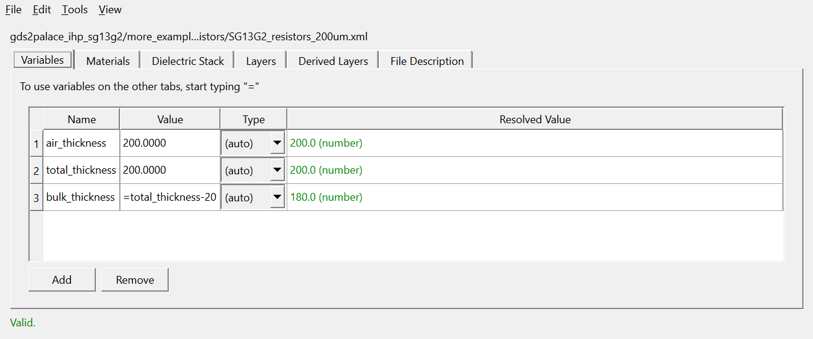

# What's New - October 31, 2026

**After a new export from the layout tool** (setupEM): a layout tool such as the KLayout plug-in klayout_em_export writes the GDSII file and a `.simcfg`, and writes both again when the layout changes. The settings you made in setupEM since are only in your model script, because Create Model writes the script, not the `.simcfg`. setupEM now takes from such a `.simcfg` only the ports, GDSII file, stackup, cell and purpose, and keeps everything else as in the script:
- Opening a `.simcfg` when a newer model script for the same GDSII file exists asks whether to **Continue with the script** (edit it in place, ports and layout settings from the `.simcfg`) or **Start from the config**.
- Loading a `.simcfg` while editing a script in place lists the ports and layout settings that differ and asks whether to **Update the script from it** or **Open it as a new model**. Before, loading it ended editing in place and replaced all settings.
- While editing a script in place, the bar below the menu points out a newer `.simcfg` of the same GDSII file with other ports or layout settings, with **Update from it**.

# What's New - October 29, 2026

**File > Edit \*.py model in place** (new, setupEM and setupThermal): edits a gds2palace model script directly, e.g. one from the gds2palace MCP server, an example or your own code. Create Model and **File > Save** write only the values you change; the script's loops, comments and custom code stay. Settings the script computes itself are greyed out. A script that builds several models (a parameter sweep) lists them on the Create Model tab, and Start Simulation runs the ticked ones. After importing a script that setupEM didn't write, a bar below the menu offers **Edit in place instead**.

**File > Import from \*.py model** now runs a gds2palace script to read it, without reading the GDSII file and without meshing. The run stops where the script builds the model, so its solver start never runs. The import now gets exactly what gds2palace would get, also values and ports the script computes. Before, ports made in a loop (as in many gds2palace MCP scripts) were left out, and the imported model was missing them. The script's own code before building the model does run, e.g. a script that generates its GDSII file writes it. If the run fails, the import reads the script text as before, and the bar below the menu says why.

**File menu:** the three Recent submenus are now one **Open Recent** submenu, with sections for configs, imported \*.py models and \*.py models edited in place. A file reopens the way it was opened. The menu is grouped as open, recent, save, preferences. **Load Default Config** and **Save as Default Config** are removed: defaults for new models are set in **File > Preferences**. An existing `default.simcfg` / `default.tsimcfg` in your home directory still opens with **Load Config**, and **Save Config** can write it.

Import and edit in place now read a stackup given as `utilities.get_stackup_path("SG13G2_FEM_200um.xml")`, the way the gds2palace MCP server writes it (needs gds2palace 0.9.1 or later). Before, an imported model using that syntax had no stackup file.

# What's New - October 21, 2026

**Tools > Simplify GDS:** the simplification code moved to gds_prepare_for_EM (module `gds_simplify_for_em`), where the gds2palace MCP server uses it too. setupEM now requires gds_prepare_for_EM 1.6.0 or later; `pip install --upgrade setupEM` updates it.

Fix: with **Merge via arrays** (and no fill removal or merging per layer), the simplified file still contained the original subcells as extra top-level cells. Without a cell name, gds2palace reads the first top-level cell, which could be one of them, e.g. a pad cell instead of the design. These left-over cells are now removed.

# What's New - October 19, 2026

**Stackup Editor, ADS Momentum (*.ltd) import:** metals with an EXPAND thickness operation now make the dielectric next to them thicker, as in ADS, instead of reaching into the dielectric below. Before, a thick EXPAND DOWN metal (e.g. MET1/MET2 in a GaAs stackup) overlapped the layers underneath it, and a via could end up with zero height. Files where long lines are wrapped or END_... markers follow the last entry on the same line now import too; before, they failed with "No usable dielectric slabs".

# What's New - October 18, 2026

**Touchstone files with different port impedances:** the option line of the combined `.sNp` file now has one Z0 per port, in port order. Before, ports with the same Z0 as port 1 were left out.

# What's New - October 17, 2026

**Conductor model** replaces **Conductor meshing** on the Mesh and Boundaries tab (Palace only), with a third choice: **Surface impedance** (default, as before), **Solve inside (volume mesh)** and the new **Solve inside + skin layers**, which adds thin layers along the conductor faces for accurate Q and loss at high frequency. Generated model scripts now use `settings['conductor_model']` instead of `settings['filled_metals']`. Older projects and model scripts with `filled_metals` still load. setupEM now requires gds2palace 0.9.0 or later; `pip install --upgrade setupEM` updates it.

# What's New - October 16, 2026

**Boundary conditions per side:** **Advanced...** next to **Boundary conditions** on the Mesh and Boundaries tab opens a table with the six sides of the simulation box. Each side can have its own boundary condition (**Absorbing**, **PEC** or **PMC**) and air layer thickness; a blank entry uses the value from the tab. For example, **PEC** at zmin with 0 µm air models a backside ground plane at the box boundary. This replaces the "same on all sides / different per side" choice for the air layer, which now lives in the same table.

Loading a model with different boundary conditions per side no longer changes it to one condition for all sides: before, a single **PEC** side turned all six sides into PEC.

**Stackup Editor:** while the stackup has errors, the cross-section preview can't be redrawn and keeps the last valid drawing. It is now marked as not up to date: dimmed, crossed by a thin red line, with a banner above it. **Show errors** in the banner opens the editor's XML Preview tab, which lists the errors. The status line now points there too, instead of to Save.

# What's New - October 12, 2026

**3D Field Viewer: value markers.** Check **Probe** in the View box (or press **P**), then click the model to place a numbered marker with the field value at that exact point. Clicking works from any angle, on the full model, the clipped solid, its cut face or the **2D plane only** section; dragging still rotates. Markers are drawn on top of the model, so a marker on a buried body stays visible. A **Markers** list opens beside the view with the marker number, value and x / y / z in µm, plus **Remove**, **Clear** and **Copy** (tab-separated, for spreadsheets). For Elmer thermal temperatures, a dropdown switches the list and labels between **K**, **°C** and **ΔT** (rise above the lowest temperature in the model, in K). Right-click the model for **Jump to Maximum in Cut Plane** (with the clip plane on), **Jump to Maximum on Surface of Body N** (the outer surface of the body you clicked, e.g. the chip; results without body IDs use the whole shown surface), **Add Marker Here**, **Remove Marker N** and **Clear Markers**. Markers are updated when you change the field, result file or cycle; markers outside the new model are removed. Ported from EMStudio's field viewer.

**3D Field Viewer: keys.** With the 3D view focused: **R / F / Home** reset camera, **I** isometric, **X / Y / Z** axis views (**Shift**: negative side), **+ / −** zoom, arrow keys pan, **O** parallel projection, **M** find max., **A** arrows on/off, **P** probe, **PgUp / PgDn** move the clip plane. VTK's own letter keys (e.g. **w** wireframe, **3** stereo, **q** / **e** which stopped the interactor) no longer do anything. The right-click menu now opens only on a click: a right-drag zooms without the menu popping up afterwards.

**3D Field Viewer:** the **Cycle** picker of a Palace field dump showed Palace's extra AMR error-indicator cycle as a frequency, e.g. "999 GHz (cycle 2)". It is now listed as "error indicator (cycle 2)". This happened when that cycle stores its Indicator/Rank values as point data. Dumps that store them as cell data were already listed as "geometry".

**3D Field Viewer:** running `field_viewer.py` / `fieldViewer` standalone with a window failed in Python environments that also have PyQt5 installed. Fixed.

**Port de-embedding in `scripts/combine_extend_snp.py` fixed** (the `_deembedded.sNp` and `_dc_deembedded.sNp` files): the negative inductance of all ports was put in series at port 1, and the other ports were not de-embedded. For a 3-port, port 1 got the sum of all three values. Now each port gets the value for its own port number; a port without geometry data in `port_information.json` is not de-embedded. The raw `.sNp` and the `_dc.sNp` files were not affected. Please run `combine_snp` again to create the de-embedded files again. The same bug was fixed in gds2palace, where Gianluca Simone and David Lurz (FAU) found it.

# What's New - October 8, 2026

**Loading the wrong kind of model:** setupEM and setupThermal now tell you when a file belongs to the other app. A `*.simcfg` file opened in setupThermal or a `*.tsimcfg` file opened in setupEM shows a message naming the app to use instead. An imported `*.py` model script that is a thermal model (`create_elmer_thermal`, heat sources) in setupEM, or an EM model (`create_palace`/`create_elmer`, ports) in setupThermal, asks for confirmation first; the default is not to import.

# What's New - October 7, 2026

**Layout Preview:** the bottom bar now shows the live cursor position (X/Y in um, GDS orientation). Press **M** to measure distances: click the start point, move the mouse to see the live distance, dx and dy, click the end point to fix it. The next click starts a new measurement, **M** or **Esc** leaves measure mode. Dragging still pans while measuring. The mouse pointer is now an arrow (a crosshair in measure mode) instead of a hand while no button is pressed, so the position is easier to identify.

**3D Field Viewer:** new **Scaled** checkbox next to **Show arrows**. When on, arrow length and color follow the field value, using the same colormap, linear or log scale, and Min/Max (or dB Range) as the legend. Arrows below the lower limit are hidden; the smallest visible arrow is never shorter than 15% of the longest. The arrow color swatch is not used while Scaled is on. The command line field viewer has a matching `--arrows-scaled` option.

# What's New - October 5, 2026

**Import Model** (*.py) with several GDS purposes (datatypes), e.g. `settings['purpose'] = [0, 35, 4]`, now works: the purpose field shows "0, 35, 4" and the model uses all three. Before, the field showed "(0, 35, 4)" and no datatype matched, so the layout preview and the model had no polygons on any layer. Models with a single purpose were not affected. A single number in the script (`settings['purpose'] = 0`) is now also read as `[0]`.

# What's New - October 2, 2026

**3D Field Viewer:** with **Log color scale**, a **Range** dropdown (-10, -20 ... -70 dB below Max) replaces the Min field; the default is -70 dB. dB means 20·log10 for E and B fields and 10·log10 for power-like arrays such as S or the energy densities. Switching to another result file or cycle now keeps the selected field (if the new data has it; a field you picked comes back as soon as it is available again) and keeps the camera view, zoom and clip position if the new mesh has the same bounding box, e.g. another AMR iteration or the matching "boundary" file. Only a file with different bounds resets the view.

**Tools > Simplify GDS...** has a new step **Merge via arrays** (default off), with a merge distance (default: the via array merge distance from Preferences). Vias closer than this distance are merged into one shape, but only if they connect the same metal shapes above and below, so merging never shorts different metal shapes. The via layers and the metal layers above and below them come from the loaded XML stackup. Vias without metal above or below are kept unchanged. Merged vias in the file are treated as solid metal in the model: fill factor correction needs the original vias, which are then no longer in the file. For accurate via resistance, merge vias in the model instead (via array merge distance > 0 with fill factor correction). gds2palace prints a note when fill factor correction is on and the vias in the file seem to be merged already. Requires gds_prepare_for_EM v1.3.0 or later.

The via array merging of the models themselves (gds2palace `merge_polygon_size`) no longer shorts different metal shapes either, with gds2palace v0.8.1 or later.

# What's New - September 30, 2026

The **Adaptive mesh refinement (AMR)** group on the Mesh and Boundaries tab is now called **Solver & Adaptive Mesh Refinement (AMR)** and has a new Palace linear solver setting, shown with **Show advanced configuration** = **Yes**. 

**Complex coarse solve** (default **Yes** for every model, set in **Preferences > Palace**) lets Palace's direct coarse solver factorize the full complex system instead of only its real part. With **No** (Palace's own default), some models don't converge at some frequencies and get wrong S-parameters there: a D-band line failed at 170 GHz, and an inductor failed at 2.4 GHz with 1.1 nH instead of 2.5 nH, while it converged at 0.1 and 10 GHz. With **Yes** both converged in 1-31 iterations and ran 3.5-6x faster. Models that already converge give identical results in about the same or less time. The cost is peak RAM, depending on the model 1.0-1.6x at order 2 and 1.5-1.9x at order 1; the AMR RAM estimate includes this. 

**Maximum solver iterations** (400) and **Solver tolerance** (1e-6) can now be changed too, in **Preferences > Palace**. These settings require gds2palace v0.8.0 or later and are hidden with an older version. setupEM module installation now requires gds2palace v0.8.0 or later, which also restores the dielectric loss tangent in Palace models that had been deleted by mistake.

**Conformal AMR (experimental)** is a new advanced setting in the **Solver & Adaptive Mesh Refinement (AMR)** group (default **No**, set in **Preferences > Palace**). With AMR iterations > 0, it switches Palace from its default nonconformal (hanging-node) mesh refinement to conformal refinement (gds2palace `settings['adaptive_mesh_conformal']`). In the test cases so far it converged in fewer AMR iterations (D-band balun: 2 iterations instead of 4, in half the time), but the mesh cell count grows faster per iteration.

setupEM now warns when Palace's linear solver does **not converge**: Palace carries on and writes S-parameters for that frequency anyway, but they are unreliable. Each case gets a ⚠ warning in the Log panel with its frequency, and all of them are listed again at the end of the run.

# What's New - September 29, 2026

The built-in **3D field viewer** now shows frequencies instead of bare numbers: the **Cycle** picker of a multi-frequency Palace field dump lists e.g. "6 GHz (cycle 1)", and Palace's extra error-indicator dump is listed as "geometry" right away. For Elmer (EM), each result file in the **Result File** picker shows its frequency, e.g. "fields_t0002.vtu - 7.5 GHz". The cycle number is kept in the label, so it still matches `field_viewer.py --cycle <N>`.

# What's New - September 26, 2026

**Result Viewer**: new frequency **Marker** that reads out all curves at the same frequency, shown on the plots and in a table below. Set it by clicking a plot, typing a frequency or using the Left/Right arrow keys; right-click a plot to jump to the (next) min/max.

The **AMR maximum DOF** setting now shows an estimate of the RAM that Palace will need at that mesh size, both on the Mesh tab and in Preferences > Palace. The estimate is based on existing Palace results (about 12 GB per million DOF, up to 15 GB). On the Mesh tab, it turns into a warning when the worst case exceeds the **"Stop Palace if memory exceeds"** limit.

**Stackup Preview**: three or more layers at the same height (e.g. resistor sheets on top of Activ) are now drawn side by side instead of on top of each other, via labels sit near the upper end of the via, and sheet resistance labels show the correct unit (e.g. RHIGH: Rs=1360 Ω, was shown as 1360000 mΩ).

The bundled stackup files now include the latest parameterized gds2palace stackups for EM and thermal simulation: **SG13G2_FEM_200um.xml**, **SG13G2_FEM_200um_passi3D.xml** (conformal passivation around TopMetal2) and **SG13CMOS5L_200um.xml**. Chip and air height can be changed with the **Override stackup Variables** table. The previous SG13G2_100um.xml, SG13G2_200um.xml and SG13G2_nosub.xml are still included, so existing models keep working.

# What's New - September 25, 2026

Added a **Correction for via array cross section** option on the Input Files tab, below via array merging, in setupEM (Palace and Elmer) and setupThermal. Merging fills the gaps between vias with via material, which overestimates the conductivity of a via array; when enabled, the conductivity of each merged via polygon (heat conductivity for thermal models) is multiplied by its fill factor (original via area / merged polygon area). This option requires gds2palace v0.7.0 or later and is hidden with an older version, which would silently ignore it.  

# What's New - September 22-24, 2026

Added a **Conductor meshing** option (Palace only) on the Mesh and Boundaries tab: **Surface impedance** (default, as before) or **Solve inside (volume mesh)**, which models conductors as solid bulk-conductivity volumes instead - more accurate at low frequency, at the cost of more RAM/simulation time and reduced accuracy at higher frequencies. This option requires gds2palace v0.6.0 or later, earlier version silently ignore this setting.  

Better display in **Stackup Preview**'s for metals/vias that push outside their base dieelectric.  

Palace's real memory usage is now measured directly from the running solver process(es) instead of parsed from its own log output, which could be inaccurate - this also makes the **"Stop Palace if memory exceeds"** kill switch more reliable.

The built-in **3D field viewer** can now switch between the results of a multi-frequency Palace field-dump ("fdump") run: a new **Cycle** picker appears whenever the loaded result file has more than one solved frequency, and `field_viewer.py --cycle <N>` selects one from the command line. Previously the viewer could only ever show one fixed cycle of such a file, with no way to see the others.

Added **File > New**, which resets setupEM/setupThermal to the same blank state as a freshly started application - useful for starting a new model without restarting the app.

# What's New - September 16-20, 2026

Fixed a native crash in the 3D field viewer that could occur when dragging the clip-plane position or opacity slider, especially on large/complex fields (mainly reported on Linux). The clip-plane, opacity, and arrow-size sliders now only update the view once you release the slider, rather than redrawing on every tick while dragging.

The Result File picker's entries are now labeled so files that share a name across different folders (e.g. per AMR iteration, per excitation) are no longer indistinguishable from each other. Adaptive mesh refinement's per-iteration copies are also hidden from the list by default, with an **Include AMR iterations** checkbox to show them, keeping the picker short for AMR runs.

Fixed an intermittent "Process error: the program could not be started" when clicking Preview, Create Mesh, or Start Simulation after a previous run left a now-deleted or otherwise stale working directory behind.

Fixed setupEM/setupThermal becoming unresponsive when loading a large, densely-arrayed GDS file. **Layout Preview** now warns (with a cancel option) if the selected layout has too many polygons to load smoothly. Separately, just browsing to such a file (or switching to the Ports/Thermal tab) no longer hangs while computing port/thermal-source layer hints.

# What's New - September 14, 2026

Added a built-in **3D field viewer**, an in-app alternative to launching external ParaView, for setupEM (Palace and Elmer-as-EM-solver) and setupThermal (Elmer thermal) field-dump results. It has a single, axis-aligned (X/Y/Z) clip plane with a **Find max.** button that jumps straight to the largest value of the current field along that axis, standard CAD/ParaView-style +/-X/Y/Z view buttons, plus opacity and mesh-edge overlay controls. For a vector array, **Show arrows** overlays direction arrows sized from an **Arrow size** slider, auto-scaled on a log magnitude scale so weak and strong regions both stay visible. When more than one equally-valid result file exists (e.g. Palace's "driven" field dump and its separate "driven_boundary" one), a picker lets you choose between them instead of guessing.

**View fields in Paraview...** and the previous separate **View fields (3D viewer)...** button are now one **View fields (...)...** button, whose label shows which viewer it opens. Choose **Built-in** (new default) or **ParaView** on the new **Preferences > Viewer** tab (renamed from **Create Model** in setupEM, which also still has the Model Fit/status-line toggles there). If ParaView is selected but not found on your system, setupEM/setupThermal fall back to the built-in viewer automatically, with a message in the Log panel explaining why.

Layout Preview now shows a via port's **effective centerline** when its drawn marker has finite size in both x and y: gds2palace's `add_ports()` collapses the shorter axis down to its minimum edge (not the true center, despite what the user guide says) when building the actual simulated port sheet, so this line makes that reduction visible before you run the simulation instead of it only showing up as a surprise in the results.

# What's New - September 8-12, 2026

Added two reserved stackup materials that need no `<Materials>` entry: `PEC` (ideal conductor, on conductor/via/sheet Layers) and `AIR` (built-in default dielectric, overridable).  

Added a **live solver-status line** below the log during a Palace run, showing MPI process count, estimated total memory, current port/frequency progress, and AMR iteration - updates as Palace's own console output streams in, without waiting for the run to finish. It clears when loading a different model/config file or creating a new mesh, instead of showing a previous run's stale data.

Added a **memory limit** for Palace runs (Preferences > Palace, "Stop Palace if memory exceeds", default 100 GB): if the solver's own reported memory usage crosses this, setupEM terminates it automatically and still runs S-parameter postprocessing on whatever results were already computed, instead of losing the whole run to an out-of-memory crash.

The **Result Viewer** can now show S-parameter results from a still-running (or crashed/stopped) multi-iteration AMR run, reading Palace's raw per-iteration output directly instead of waiting for the whole run to finish. 

Added a **Layout Preview** which can be accessed from Input Files tab or Tools menu, including display of port location and direction. Layout layers selected in Stackup Preview will be highlighted in Layout preview.

Added **Tools > Simplify GDS...** (setupEM and setupThermal), which removes floating (unconnected) metal fill and/or fills in small cutouts on the currently loaded GDS file, writing the result to a new GDS file. The metal layers it operates on come entirely from the currently loaded XML stackup. Defaults are configurable on a new Preferences > Simplify GDS tab. A **Compare in Layout Preview** button opens the original and simplified layouts side by side.  

**Layer numbers for port shapes** are now auto-detected when creating port configuration. Layer range is set in the Preferences dialog.

Added a **File > Preferences...** dialog (setupEM and setupThermal) for changing the built-in defaults of fields that were previously hardcoded. 

The **Cellname** dropdown now shows an explicit "(default)" entry instead of a blank one.

# What's New - September 1-6, 2026

The stackup cross-section preview (**Show stackup**, and the Stackup Editor's live preview) is now interactive: click a dielectric, metal, or via to see its name, material, and z-position/thickness in a flyout. In the Stackup Editor, clicking a shape also selects the matching row in the Dielectric Stack/Layers tables, and selecting a row highlights the matching shape in the preview.

The Stackup Editor now closes itself automatically when a different substrate XML is chosen in the main window, if it has no unsaved changes, instead of staying open showing a file that no longer matches what's selected.

setupThermal now has an **Elmer solver settings** group (Mesh tab), matching setupEM's, to choose between the iterative and direct linear solver for the Elmer thermal solve - defaults to direct. Previously this could only be set by hand-editing the generated model script, and the setting was silently dropped even then.

ParaView launching (Palace and Elmer EM field dumps, Elmer thermal results) now prefers a `.pvtu` file over loose `.vtu` pieces when one exists, so a multi-partition (MPI) run opens as one combined dataset instead of disconnected fragments.

The Frequencies tab's field-dump control is now solver-aware: Elmer mode shows a plain **"Enable field dump"** checkbox instead of a frequency list, since Elmer has no per-frequency `SaveStep` like Palace - any `fdump` value there dumps fields at *every* solved frequency (sweep and `fpoint` together), so listing specific frequencies was misleading. Palace mode is unchanged, keeping its per-frequency `fdump` list. This also sidesteps a gds2palace bug (see its own CHANGES.md) where a frequency listed in both the sweep and `fdump` was silently solved twice.

# What's New - September 5, 2026

Added a **View fields in Paraview...** button (Create Model tab), shown once `fdump` is set, to open Palace or Elmer EM field-dump results directly. "View Results..." is renamed to **View S-Parameters...** for clarity.

Fixed Elmer EM simulations failing to start on Windows: the run script never actually launched (silently, with no log output), and MPI-enabled runs now check that Microsoft MPI is installed first, with a clear message and download link if it's missing instead of a cryptic failure.

Fixed importing an existing model file and choosing to reuse its filename: it could silently rename the output to a different file than the one imported. Fixed `fdump`/`fpoint` showing raw Hz values instead of GHz after importing a model file. `fdump` is now usable in Elmer mode too (previously hidden).

# What's New - September 1, 2026

Added a built-in **Result Viewer** (Create Model tab > View Results...) for browsing Touchstone S-parameter results without leaving setupEM: a file tree grouped by run folder (check a whole folder or individual files), dB/phase or Smith/zoomed-Smith charts with a shared legend, and `_dc`/`_deembedded` filter checkboxes. Also runnable standalone via the `resultViewer` script.

Added a **Model Fit...** button (Create Model tab, next to View Results...) that launches [snp2le](https://github.com/iic-jku/snp2le) on the current run's raw S-parameter result to extract a lumped-element netlist - offering to install snp2le via pip automatically if it isn't already present.

**Start Simulation** now checks whether the output directory already holds results from a previous run, and asks whether to delete or keep them (default: delete) before launching the solver, so old and new results don't get mixed together.

Added a "slower, most accurate (N=3)" mesh basis function option, available in Palace mode only since Elmer doesn't support it. Fixed the Frequencies tab silently dropping (or reusing stale) `fstart`/`fstop` when left blank.

# What's New - August 21, 2026

Changes since the version from about 3 months ago, focused on features that matter to end users. For general usage, see the main [README](../README.md).

## New Stackup Editor

A new graphical **Stackup XML Editor** is available from the **Tools > Edit Stackup XML...** menu in both setupEM and setupThermal. Previously, stackup XML files had to be edited by hand in a text editor.

The editor lets you manage all parts of a stackup file:
- **Materials** (dielectrics and metals, including color coding)
- **Dielectric stack** (layer order and thickness)
- **Drawn layers** (the GDSII layers used for geometry)
- **Derived layers**: new boolean/resize operations (AND, OR, NOT, grow/shrink) that combine or modify existing drawn layers to create additional layers, without needing a separate layout preprocessing step

Edits are shown live in a cross-section preview, the same visualization used by "Show stackup" elsewhere in the app. Saving preserves any comments and formatting in the original XML file that the editor doesn't touch.

## Reference-relative stackup positioning

The Stackup Editor's Dielectric Stack and Layers tabs now support an additional way to position a layer: instead of an absolute Zmin/Zmax, a Dielectric or Layer can reference the top or bottom edge of another one, with an offset. This means a stack no longer needs every z-position hand-recomputed whenever a Dielectric's thickness changes - layers positioned this way track the change automatically. The Result columns show the resolved absolute position either way, so it's always visible regardless of which mode a row uses.

Use **Tools > Convert to Reference position format** in the Stackup Editor to convert an existing stackup file (using absolute positions) to this format in place; the physical layer positions stay exactly the same, only how they're expressed in the XML file changes.

Files using this feature require the newer `schemaVersion="3.0"` stackup format. If you save changes to an older-format file that has since been converted, the editor will ask whether to overwrite the original file or save the upgraded version separately, so an old-format file is never silently replaced. You may also see a console/log warning from gds2palace if a stackup file declares a newer schema version than your installed gds2palace version supports.

## Variables tab in the Stackup Editor

The Stackup Editor now has a **Variables** tab for defining named values (plain numbers/text, or `=expression` referencing other variables) that can be reused across the whole stackup file. Type `=` into any numeric-capable cell on the other tabs to get an autocomplete list of declared variables.

This matches the `<Variables>`/`"=expr"` XML format gds2palace's stackup reader supports as of `schemaVersion="3.1"` - see the [XML stackup format doc](https://github.com/VolkerMuehlhaus/gds2palace_ihp_sg13g2/blob/main/doc/XML_stackup_format/XML_stackup_format.md) for the underlying format. Existing files and scripts that don't use Variables are unaffected.

## Override stackup Variables from setupEM / setupThermal

Choosing a substrate XML file that declares `<Variables>` now shows an editable grid of them right below the file description, on the Input Files tab of both setupEM and setupThermal. Change a value there - e.g. `total_thickness` or `air_thickness` - to override it in the generated model script, without hand-editing the XML file or the script itself. The grid only lists plain values, not ones computed from other variables, and stays hidden entirely for files that don't declare any Variables.

## setupThermal: a new companion app for thermal simulation

setupEM now installs a second program, **setupThermal**, alongside setupEM. It provides the same kind of guided, tabbed interface as setupEM, but for building thermal simulation models instead of S-parameter models.

- Uses the [Elmer](https://www.elmerfem.org/blog/) FEM solver instead of AWS Palace. Elmer must be installed separately.
- Reuses the same gds2palace stackup workflow as setupEM, so layout and stackup files work the same way.
- Start it the same way as setupEM: with your venv activated, simply type `setupThermal`.

## Thermal Tables tab in the Stackup Editor

The Stackup Editor now has a **Thermal Tables** tab for editing the temperature-dependent thermal conductivity data used by the Elmer thermal flow. It's a master/detail view: the top grid lists every named table (with a live point count), and selecting a table shows its individual Temperature/Value points below. A Material's **Thermal Table** column is now a dropdown listing the tables declared on this tab (it can still hold a `=variable` expression, e.g. to pick between a literature and a measured dataset), instead of a free-text field with no connection to the actual data.

Points don't need to be entered in temperature order - they're sorted automatically when the file is saved, since Elmer reads them as a piecewise-linear lookup curve and needs them in order to interpolate correctly.

## License correction

Corrected a license inconsistency: the repository's LICENSE file said Apache-2.0, while every source file's own header comment already said GPLv3. The code headers were correct - setupEM imports gds2palace's Python API directly in-process, and gds2palace is itself GPLv3, so GPLv3 is the license actually required here. LICENSE, `pyproject.toml`, and the two files that had no header now all agree on GPLv3.

## Faster, more informative Palace runs on Windows

**Start Simulation** on Windows no longer opens a separate WSL terminal window and waits for you to type `./run_sim` yourself. It now runs `./run_sim` directly inside WSL and streams Palace's console output live into the Log panel, exactly like the existing Linux behavior - no terminal window appears at all. This also means **Terminate** now actually stops a running Windows/WSL simulation, and the Log panel accurately reflects when the run has really finished (previously the terminal launcher returned almost immediately, long before Palace itself was done). This still only works for simulation directories on a local drive - WSL cannot reach a network drive.

When a Palace simulation finishes, a **results summary** is now appended to the Log panel automatically: degrees of freedom, mesh element count, simulation time, peak RAM, and the mesh-adaptation error indicators (Norm/Max/Mean), read directly from Palace's own `palace.json` and `error-indicators.csv` output files. For a run using adaptive mesh refinement, this is a table with one row per refinement iteration plus the final converged result, so you can see how DOF and error indicators evolved across iterations at a glance.

